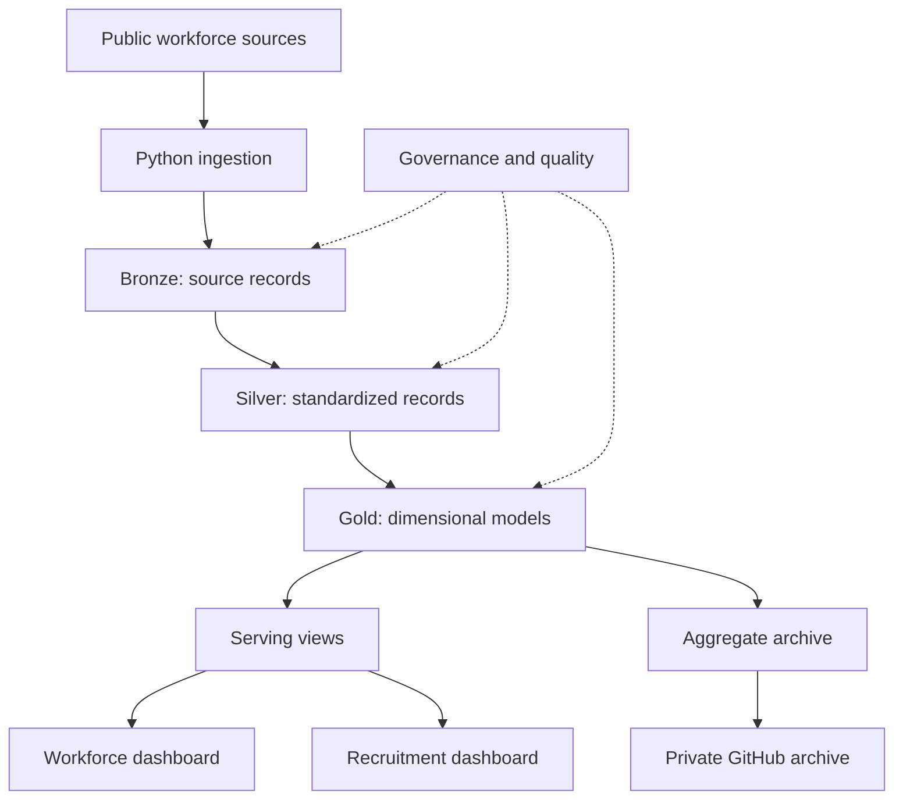

# Indiana Workforce Intelligence Platform

## Executive overview

An independent portfolio implementation of a governed workforce data and analytics platform supporting labor market analysis, occupational planning and state government recruitment intelligence. This is not an official State of Indiana system.

## Architecture

The platform uses Microsoft SQL Server, Python, SQL, R Shiny, Plotly, ODBC, Windows Task Scheduler, Git and GitHub. Apache Airflow and Docker were evaluated as a separate orchestration proof of concept.

## Data sources

| Source | Dataset | Purpose |
|---|---|---|
| STATS Indiana | LAUS | County and statewide unemployment |
| BLS | LAUS | Statewide labor market indicators |
| BLS | OEWS | Occupational employment and wages |
| Indiana DWD | Occupational projections | Long-term employment demand |
| Work for Indiana | Public job advertisements | Recruitment intelligence |

## Data architecture and governance

- Bronze preserves source records, collection metadata and provenance.
- Silver implements normalization, business-key validation, posting lifecycle management and compensation assessment.
- Gold provides dimensional models, analytical facts and daily recruitment aggregates.
- Serving provides dashboard-facing views and validated workforce publication objects.
- Control and quarantine schemas support quality rules, pipeline monitoring, publication tracking, reference mappings and rejected observations.
- Agency aliases are standardized in recruitment serving views. Compensation assessments retain evidence, parser versions and source lineage.

## Analytical applications

**Workforce dashboard:** unemployment, labor market trends, occupational wages and employment projections.

**Recruitment dashboard:** active postings, newly observed postings, removals, reactivations, cumulative unique postings, agency and city distributions, detected skills, searchable inventory, compensation and collection quality.

The applications run separately on local interfaces.

## Compensation methodology

Reviewed corrections take precedence over automated assessments. The parser prioritizes unambiguous job-description base salaries, with strictly validated listing values as fallback. Ambiguous values remain unresolved. Hourly rates are annualized using 1,950 hours as an FTE estimate, not guaranteed earnings. Explicit frequencies are distinguished from source assumptions. Silver and Gold compensation values are reconciled after assessment.

## Security and operations

Windows Integrated Authentication, role-based database permissions, restricted dashboard views and a dedicated ETL identity proof of concept establish the security foundation. Current operational tasks and dashboard connections still use the configured Windows user identity; production least-privilege deployment is outstanding.

Windows Task Scheduler runs workforce and recruitment workflows. Recruitment processing collects daily inventory, selectively retrieves details, updates posting lifecycle records, assesses compensation, reconciles analytical tables and exports an approved aggregate archive. SHA-256 checksums and repository checks protect archive synchronization. Same-day protection prevents duplicate daily collection. Raw data, credentials, logs, packages and backups are excluded from Git.

## Validation snapshot — November 27, 2026

| Metric | Result |
|---|---:|
| STATS Indiana LAUS observations | 4,372 |
| Geographic areas | 93 |
| BLS LAUS observations | 132 |
| Occupational wage records | 784 |
| Occupational projection records | 893 |
| Active recruitment postings | 468 |
| Daily recruitment observations | 2 |
| Automated salary assessments | 468 |
| Reviewed salary overrides | 14 |
| Available standardized salaries | 461 |
| Explicit salary frequencies | 142 |
| Assumed annual frequencies | 319 |
| Unresolved salaries | 7 |
| Salary availability | 98.50% |

Compensation reconciliation, dashboard rendering, restricted dashboard-role testing, same-day pipeline execution and aggregate archive integrity checks passed. Availability is not a measure of extraction accuracy.

## Repository organization

- `database/scripts/`: SQL schema, transformation, governance and security scripts.
- `scripts/etl/`: ingestion, lifecycle, compensation and archive processing.
- `scripts/`: pipeline entry points and runtime tests.
- `dashboard/shiny/`: workforce application.
- `dashboard/recruitment/`: recruitment application.
- `orchestration/airflow/`: orchestration proof of concept.
- `docs/`: architecture, governance, security, operations and validation documentation.

## Known limitations and roadmap

- Daily snapshots may miss short-lived advertisements; disappearance does not establish why a posting closed.
- Salary extraction is not independently accuracy-audited; ambiguous multi-role statements and unrecognized wording remain limitations.
- Skills are keyword detections, not verified mandatory qualifications.
- Source reporting gaps and historical revisions require additional controls.
- Recruitment serving uses live views; compensation and lifecycle transactions do not constitute atomic publication.
- Fresh-day integration testing of the updated recruitment pipeline remains outstanding.
- Dedicated least-privilege runtime deployment, enterprise disaster recovery and cloud deployment remain future work.

## Project status

Local functional implementation with validated analytical outputs and scheduled automation. Production hardening and operational acceptance testing are required before enterprise deployment.
