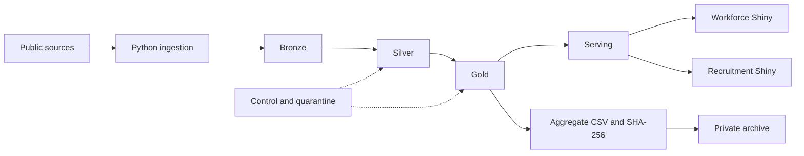

# Enterprise architecture

## Scope and business alignment
Independent local portfolio implementation for Indiana workforce planning and state recruitment intelligence. The platform supports labor market monitoring, wage analysis, occupational projections and recruitment inventory analysis. It is not an official government system.

## Logical architecture

SQL Server hosts the Medallion layers as relational schemas, not a distributed lakehouse. Bronze retains source values and provenance; Silver standardizes business entities; Gold supports dimensional analytics; Serving exposes approved analytical interfaces. Control holds operational and quality metadata. Quarantine supports rejected observations. The architecture separates analytical consumption from ingestion.

## Source inventory
| Source | Interface | Grain | Observations at checkpoint |
|---|---|---|---:|
| STATS Indiana LAUS | HTML tables in XLS downloads | Geography, year, reporting month | 4372 |
| BLS LAUS | Public API | State, series, period | 132 |
| BLS OEWS | Public source | State, occupation, release | 784 |
| Indiana DWD projections | CSV | State, occupation, projection release | 893 |
| Work for Indiana | Public HTTPS HTML | Posting per collection | 936 listing observations across two days |

LAUS covers 92 counties and the statewide aggregate; annual averages must not be mixed with monthly observations. OEWS and projections are statewide; exact SOC matches cover 764 of 893 projection records. Projection base year is not established. Education and demographic datasets are not implemented.

## Recruitment data model
Bronze StateCareers_Collection identifies collection date, source key, counts and completeness. StateCareers_Raw retains listing and detail evidence, unique by collection and source posting ID. Silver StateCareers_JobPosting maintains a unique source posting ID and separate latest listing and detail lineage. JobCompensation retains candidate evidence; JobSkill records keyword evidence. Gold Fact_StateJobPosting is one row per posting; Fact_RecruitmentDaily is one row per observation date. Dim_Agency and Dim_Skill support analysis; Bridge_JobPostingSkill resolves the many-to-many skill relationship. Geography, occupation and period keys can be nullable where mapping is unavailable.

Control AgencyAlias standardizes seven known agency labels in serving views; it does not establish a complete organizational hierarchy. Compensation assessments are keyed by posting, detail and listing identifiers; reviewed overrides are applied only when applicable source evidence remains current.

## Interfaces and deployment
Workforce serving uses validated publication snapshots. Recruitment serving uses live views: vw_StateRecruitment, vw_RecruitmentDaily, vw_RecruitmentAgency, vw_RecruitmentLocation, vw_RecruitmentCompensation, vw_RecruitmentSkills and vw_RecruitmentQuality. Recruitment lifecycle and compensation updates are separate transactions; publication is not atomic across them. Both Shiny apps run separately on the local machine. SQL Server, Python, R, ODBC 18, Windows Task Scheduler and Git are the operational stack. Airflow/Docker is a separate proof of concept, not production orchestration.

## Architecture decisions
- Local SQL Server rather than paid cloud infrastructure: low cost and reproducibility; limited elasticity and availability.
- Python for source parsing and SQL for relational integrity and transformations: clear separation of concerns.
- Separate listing and detail lineage: preserve unchanged descriptions without falsely claiming daily detail retrieval.
- Separate source and aggregate archive repositories: minimize exposure of raw data.
- Future options: managed orchestration, cloud lakehouse, metadata catalog, atomic recruitment publication, revision-aware ingestion and disaster recovery. These are proposals, not delivered capabilities.
